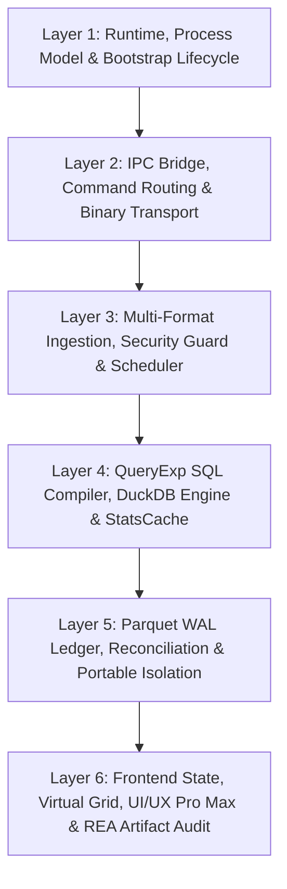

# Toad (`v2.6.0.3`) vs. Pulex (`v3.0.0`) — Comparative Analysis Methodology & Execution Plan

> **Document Classification:** Engineering Architecture & Parity Audit Plan  
> **Baseline (Predecessor):** Toad `v2.6.0.3` (Electron 42 + Node.js Utility Process + DuckDB + Rust N-API/CLI Sidecar)  
> **Target (Successor):** Pulex `v3.0.0` (Tauri v2 + WebView2 + Rust Core + Embedded DuckDB `1.2.2` + Apache Arrow IPC)  
> **Author / Publisher:** `HelloKittyXamKinLung`  
> **Companion Deliverable:** [TOAD_VS_PULEX_DETAILED_REPORT.md](file:///d:/Shared_UserData/Downloads/_Projects_SecOps/pulex/docs/TOAD_VS_PULEX_DETAILED_REPORT.md)

---

## 1. Objective & Scope

This plan defines the systematic, evidence-driven methodology used to compare **Toad (`v2.6.0.3`)** and **Pulex (`v3.0.0`)** down to individual modules, public functions, end-to-end execution flows, UI/UX design tokens, and shipped PE/archive artifacts.

### 1.1 Repositories & Artifacts in Scope

| Role | Target | Location | Mode |
| :--- | :--- | :--- | :--- |
| **Baseline Source** | Toad `v2.6.0.3` monorepo (`tad-master/packages/*`) | `D:\Shared_UserData\Downloads\_Software_Installers\toad` | Read-Only |
| **Baseline Shipped Artifacts** | NSIS Portable Wrapper (`Toad.exe`), Unpacked x64 Electron (`win-unpacked/Toad.exe`), `app.asar` | `D:\Shared_UserData\Downloads\_Software_Installers\toad\Toad.exe` & `tad-master\packages\toad-app\release\win-unpacked\` | Read-Only |
| **Target Source** | Pulex `v3.0.0` (`src-tauri/`, `packages/`, `src/`, `less/`) | `d:\Shared_UserData\Downloads\_Projects_SecOps\pulex` | Primary |
| **Target Shipped Artifacts** | Portable Executable (`Pulex-3.0.0-x64-portable.exe`) & Portable Archive (`Pulex-3.0.0-x64-portable.zip`) | `d:\Shared_UserData\Downloads\_Projects_SecOps\pulex\releases\` | Primary |

---

## 2. Six-Layer Comparative Analysis Framework

Every subsystem is decomposed across six orthogonal layers so that architectural changes (Electron -> Tauri, Node -> Rust) are evaluated alongside behavioral parity and user experience.

### Layer Definitions & Primary Comparison Axes

1. **Layer 1 — Runtime, Process Model & Bootstrap Lifecycle**
   - Process topology (Electron Main + Utility Process `engineSupervisor` + Renderer + `toad-core` N-API/CLI vs. Tauri Single Native Rust Process + WebView2 Renderer).
   - Single-instance lock, CLI argument routing, native menu bar, window creation, error traps, and clean shutdown.
2. **Layer 2 — IPC Bridge, Command Routing & Binary Transport**
   - `IHostBridge` abstraction (`ElectronHostAdapter` vs. `TauriHostAdapter`), `commandAliases.ts` normalization, `ipcMain.handle` vs. custom `dispatch_invoke` / `route_command` router.
   - Rowset transport: JSON/MessagePort serialization vs. zero-copy Apache Arrow IPC (`arrow-ipc` binary stream) over Tauri `Response::new(bytes)`.
3. **Layer 3 — Data Ingestion Pipelines & Scheduler**
   - Binary/magic-byte security guard (`binary_guard.rs` vs. `csvimport.ts::binaryGuard`).
   - Encoding detection & streaming UTF-16/Gzip transcoding (`transcode.rs`).
   - EVTX binary log parsing (`evtx_parser.rs` + PowerShell fallback removal/retention).
   - CSV/TSV delimiter sniffing, dirty-log recovery, JSON/NDJSON streaming flattener, SQLite/DuckDB passthrough, and Shortest-Job-First (SJF) / VIP queue scheduling.
4. **Layer 4 — QueryExp SQL Compiler, DuckDB Pool & Analytics**
   - `QueryExp` AST translation (`reltab` TypeScript dialect vs. Rust `engine/query_compiler.rs`).
   - Connection pooling, `PRAGMA` tuning (`duckdb_pool.rs`), derived views (`_rx*` regex extraction), column statistics (`stats_cache.rs`), and fast row counting.
5. **Layer 5 — Parquet WAL State Ledger & Portable Isolation**
   - Append-only Parquet WAL event log (`ToadParquetLedger` in `csvimport.ts` vs. `ledger/parquet_ledger.rs`), tombstones, startup reconciliation (`reconciliation.rs`), cache eviction (`cache_cleaner.rs`), and portable `toadAppData_*` / `pulexAppData_*` directory & INI config management.
6. **Layer 6 — Frontend State, Virtual Grid, UI/UX Pro Max & REA Shipped-Artifact Audit**
   - Line-by-line diff of all shared React/TypeScript/LESS/SCSS files (`actions.ts`, `DataGrid.tsx`, `DataSourceSidebar.tsx`, `RegexDialog.tsx`, `MultipleLoadingManager.ts`, `ProjectWorkspaceManager.ts`, `slickgrid.scss`, `tadviewer.less`, `toadTheme.ts`, `TextFormatOptions.ts`, `CellLineCalculator.ts`).
   - **UI/UX Pro Max** 10-category audit (Accessibility, Interaction, Performance/Containment/CLS, Visual Consistency, Layout/Responsive, Typography & Light/Dark Tokens, Motion, Forms/Loading, Navigation, Data Density).
   - **REA (`reverse-engineer-anything`)** shipped-artifact verification (PE hardening flags, PE resources/metadata, Electron Fuses vs. Tauri Capabilities/CSP, Release Exposure Audit, Archive Inventory).

---

## 3. Function-Level Equivalence Taxonomy

Every mapped function and logic flow in the companion report is classified using a strict five-state taxonomy:

| Classification | Symbol | Definition |
| :--- | :---: | :--- |
| **Full Parity** | `PARITY` | Identical functional contract, edge-case handling, and observable user outcome. |
| **Enhanced in Pulex** | `ENHANCED_IN_PULEX` | Superset behavior, stronger security/hardening, faster binary transport, or bug fix beyond Toad `v2.6.0.3`. |
| **Architectural Divergence** | `ARCHITECTURAL_DIVERGENCE` | Intentionally redesigned mechanism (e.g., Electron `MessagePort` -> Tauri `Response` Arrow IPC; Node `Worker` -> Rust `tokio`/`rayon`) achieving equivalent or superior user-level goals. |
| **Remaining Gap** | `REMAINING_GAP` | Capability present in Toad `v2.6.0.3` that is absent, degraded, or partially wired in Pulex `v3.0.0`. |
| **Deprecated / Removed** | `DEPRECATED` | Legacy Electron/Node compatibility path intentionally retired (e.g., `nodeIntegration` fallback, `toad-core.exe` subprocess IPC). |

---

## 4. Evidence Collection Protocol

### 4.1 Source & Diff Extraction Protocol
1. Inventory all source files and line counts across `toad/tad-master/packages/*` and `pulex/{src-tauri,packages,src,less}`.
2. Extract all public Rust functions (`pub fn`, `pub async fn`) in `src-tauri/src/` and `toad-core-rust/src/`.
3. Extract all IPC handlers (`ipcMain.handle`, `ipcMain.on`) in `toad-app/app/*.ts` and map 1:1 to Pulex's `src-tauri/src/commands/mod.rs::route_command` and `commands/{query,workspace,ingest,system}.rs`.
4. Run `git diff --no-index` between `toad/tad-master/packages/toadviewer/src/` and `pulex/src/` (and `less/`) to isolate every single frontend behavioral delta.

### 4.2 REA (`reverse-engineer-anything`) Shipped-Artifact Protocol
Run static shipped-artifact probes on both release targets without executing untrusted payloads:
- `inspect_binary_hardening` on `Pulex-3.0.0-x64-portable.exe`, `Toad.exe` (NSIS portable), and `win-unpacked/Toad.exe` (x64 Electron).
- `inspect_pe_resources` on `Pulex-3.0.0-x64-portable.exe` and `Toad.exe`.
- `inspect_electron_fuses` on `Toad.exe` and `win-unpacked/Toad.exe`.
- `audit_release_exposure` on `Pulex-3.0.0-x64-portable.exe`, `Toad.exe`, and `win-unpacked/resources/app.asar`.
- `open_binary` + `inspect_artifact (detail: "complete")` on `Pulex-3.0.0-x64-portable.zip`.

### 4.3 UI/UX Pro Max Evaluation Protocol
Query the local UI/UX Pro Max intelligence corpus (`scripts/search.py`) across:
- `--domain ux` (virtual scroll data tables, dark mode contrast, WCAG 2.2 focus appearance & focus-not-obscured, keyboard navigation, modal accessibility, reduced motion).
- `--stack react` (virtualized list keys, memoization discipline).
- `--domain style` (`data-dense-dashboard` design tokens and ergonomics).

Cross-check every retrieved guideline directly against Pulex and Toad's `less/*.less`, `src/slickgrid.scss`, `src/toadTheme.ts`, and React components.

---

## 5. Verification Gates & Completion Criteria

| Gate | Requirement | Verification Method |
| :--- | :--- | :--- |
| **G1: Zero Hallucinated Symbols** | Every file path, line number, function signature, and SHA-256 hash cited in the report is directly observed from disk or tool output. | Cross-checked against filesystem inventory & REA JSON evidence IDs. |
| **G2: Complete Layer Coverage** | All 6 layers (Runtime, IPC/Arrow, Ingest, Query/DuckDB, Ledger/Portable, Frontend/UI-UX/REA) documented with function tables and Mermaid diagrams. | Section-by-section audit of `TOAD_VS_PULEX_DETAILED_REPORT.md`. |
| **G3: Public Language Compliance** | 100% professional English across both `docs/*.md` files; zero non-English text or corporate identity leaks (`AGENTS.md`). | Automated Unicode/diacritic regex scan over `docs/TOAD_VS_PULEX_*.md`. |
| **G4: Repository Hygiene** | Only intended `docs/` artifacts added; Toad reference repo untouched (`Read-Only`). | `jj status` verification. |

