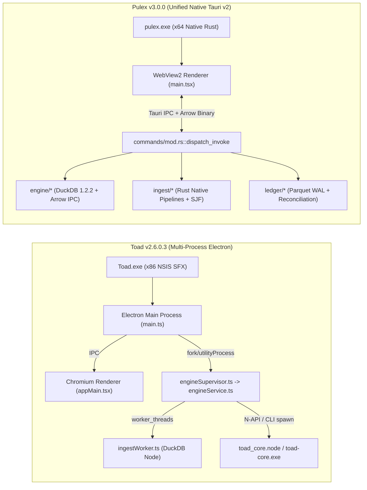
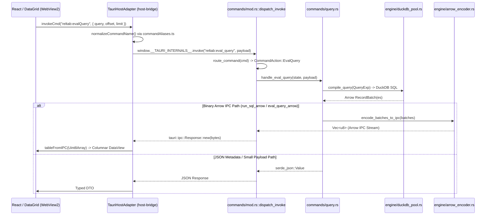
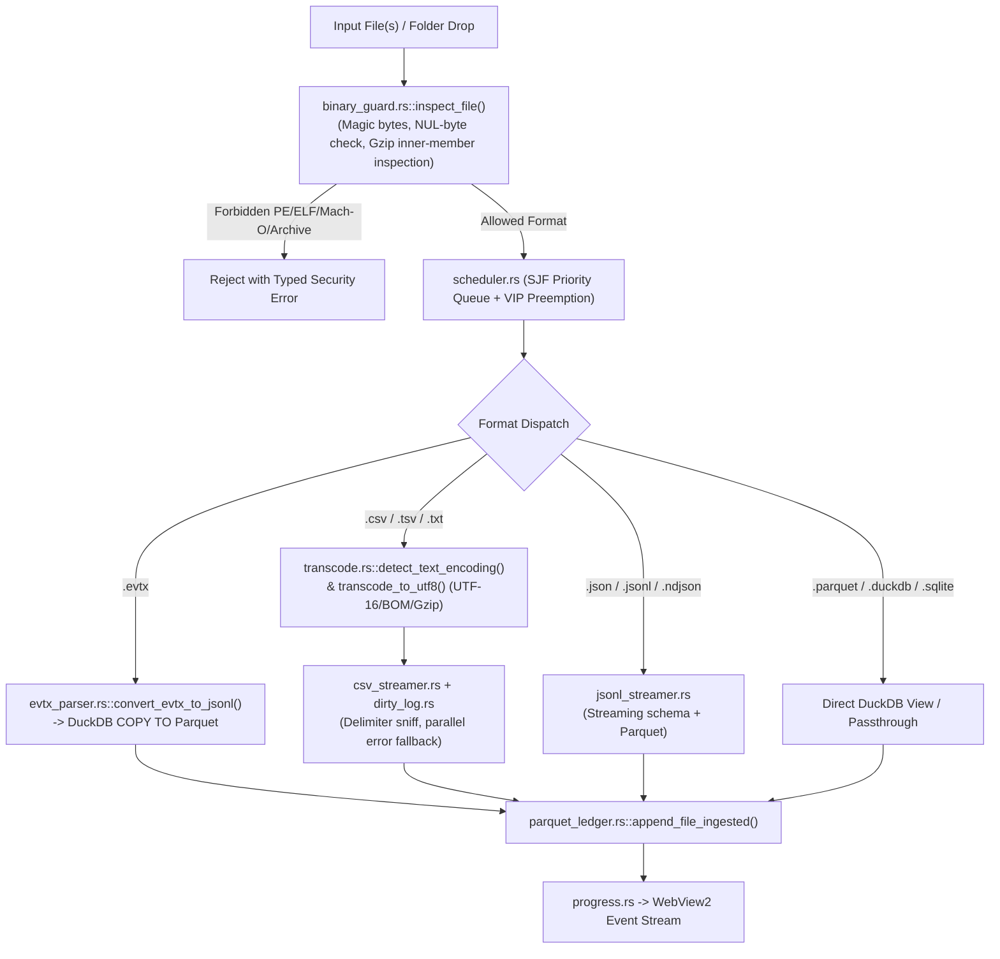
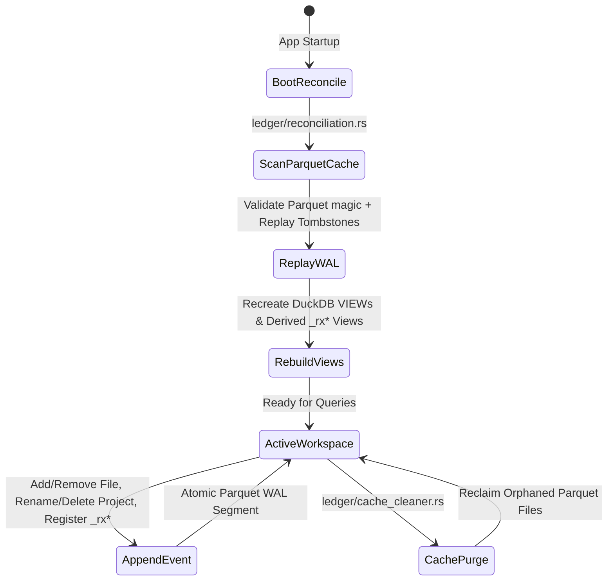

# Toad (`v2.6.0.3`) vs. Pulex (`v3.0.0`) — Deep Function-Level, Logic-Flow, UI/UX & REA Artifact Comparative Report

> **Baseline (Predecessor):** Toad `v2.6.0.3` (`D:\Shared_UserData\Downloads\_Software_Installers\toad`)  
> **Target (Successor):** Pulex `v3.0.0` (`d:\Shared_UserData\Downloads\_Projects_SecOps\pulex`)  
> **Methodology:** [TOAD_VS_PULEX_ANALYSIS_PLAN.md](file:///d:/Shared_UserData/Downloads/_Projects_SecOps/pulex/docs/TOAD_VS_PULEX_ANALYSIS_PLAN.md)  
> **Publisher:** `HelloKittyXamKinLung`  
> **Verification Pillars:** Source AST & Diff Analysis + REA (`reverse-engineer-anything`) Shipped-Artifact Evidence + UI/UX Pro Max Design Audit

---

## Executive Summary & Scorecard

Pulex `v3.0.0` is a ground-up native desktop rewrite of Toad `v2.6.0.3`, migrating from an **Electron 42 + Node.js Utility Process + N-API/CLI Rust Sidecar** architecture to a **Tauri v2 + WebView2 + Unified Rust Core + Embedded DuckDB `1.2.2` + Apache Arrow IPC** architecture while preserving the React/BlueprintJS/SlickGrid analytical frontend.

| Dimension | Toad `v2.6.0.3` (Electron) | Pulex `v3.0.0` (Tauri v2) | Delta / Verdict |
| :--- | :--- | :--- | :--- |
| **Runtime Footprint (Portable EXE)** | `97,397,723 B` (`92.89 MB`, 32-bit NSIS wrapper) | `14,715,904 B` (`14.03 MB`, native x64 PE) | **6.6x smaller** (`ENHANCED_IN_PULEX`) |
| **Runtime Footprint (Portable ZIP)** | `97,407,067 B` (`92.89 MB`) | `16,403,719 B` (`15.64 MB`, 3 binaries) | **5.9x smaller** (`ENHANCED_IN_PULEX`) |
| **Unpacked Disk Footprint** | `367,479,957 B` (`350.46 MB`, 25 files) | `44,312,144 B` (`42.26 MB`, 3 files) | **8.3x smaller** (`ENHANCED_IN_PULEX`) |
| **Backend Architecture** | Electron Main + `engineSupervisor` Utility Process + `worker_threads` + `toad-core` N-API/CLI | Unified Rust async runtime (`tokio` + `rayon` + `r2d2`/pooled `duckdb-rs`) | **Zero Node/V8 backend overhead** (`ARCHITECTURAL_DIVERGENCE`) |
| **IPC & Rowset Transport** | `ipcMain.handle` + JSON / `MessagePort` | Custom `dispatch_invoke` + Apache Arrow IPC binary (`Response::new`) | **Zero-copy columnar transfer** (`ENHANCED_IN_PULEX`) |
| **Frontend Parity (`src/` + `less/`)** | 67 TSX/TS/SCSS + 13 LESS files | 56 identical files, 11 targeted upgrades, 2 Tauri entry files | **100% functional parity + WebView2/CSP fixes** |
| **Security & Hardening (REA)** | `EnableEmbeddedAsarIntegrityValidation: disabled`, `GrantFileProtocolExtraPrivileges: enabled`, `app.asar` exposes `715` readable members, `debug_record_present: enabled`, unescaped URL `<a>` formatter | `guard_cf: enabled`, `nx_compat: enabled`, `high_entropy_va: enabled`, `debug_record_present: disabled`, `0` exposed items in REA audit, strict CSP, `he.encode()` URL formatter | **Significantly stronger posture** (`ENHANCED_IN_PULEX`) |
| **Remaining Gaps / Polish Items** | Auto-updater (`updater.ts`), `QuickStart` HTML docs, `io_monitor.rs` OS disk I/O telemetry | No auto-updater, minor `tauri.conf.json` copyright mojibake (`U+00C2 U+00A9`), UI/UX Pro Max accessibility polish (`focus-visible`, `prefers-reduced-motion`, ARIA) | **Tracked in Section 9 Backlog (`P1`/`P2`)** |

---

## Section 1: Runtime, Process Model & Bootstrap Lifecycle

### 1.1 Architectural Process Topology

### 1.2 Function-by-Function Bootstrap & Lifecycle Comparison

| Responsibility | Toad `v2.6.0.3` Function(s) | Pulex `v3.0.0` Function(s) | Status | Behavioral Delta |
| :--- | :--- | :--- | :---: | :--- |
| **Process Entry & Single-Instance** | `toad-app/app/main.ts` (`app.requestSingleInstanceLock`, `second-instance` event, `openSrcFiles` L813) | `src-tauri/src/main.rs` (`main`), `src-tauri/src/lib.rs` (`build_app` L99, `run` L163, `tauri_plugin_single_instance`) | `ENHANCED_IN_PULEX` | Pulex handles single-instance CLI forwarding natively in Rust and emits `pulex://open-files` to the focused window; zero Node cold-start penalty. |
| **Portable AppData & INI Config** | `toad-app/app/portableAppData.ts` (1212 lines: `genRandomSuffix` L266, `getExecutableDir` L280, `parseIni` L312, `initPortableEnvironment`) + `toad-core-rust/src/config_manager.rs` (523 lines) | `src-tauri/src/portable.rs` (553 lines: `init_portable_environment`, `ensure_portable_app_data_dir`, `validate_and_ensure_config`, `parse_ini`, `clean_temp_dir`) | `ENHANCED_IN_PULEX` | Toad duplicated portable/INI logic across TypeScript (1212 lines) and Rust (523 lines). Pulex consolidates into a single 553-line Rust source of truth. |
| **Window Creation & Security** | `toad-app/app/appWindow.ts` (484 lines: `webPreferences` with `nodeIntegration: isLegacy`, `contextIsolation: !isLegacy`, `preload.js`) | `src-tauri/tauri.conf.json` + `src-tauri/capabilities/default.json` + `commands/system.rs::handle_new_window` (L406) | `ENHANCED_IN_PULEX` | Pulex removes legacy `nodeIntegration` fallback completely; enforces strict CSP (`default-src 'self'; script-src 'self'`) and declarative capability scoping (`main`, `pulex_*`). |
| **Native Menu Bar** | `toad-app/app/appMenu.ts` (271 lines) | `src-tauri/src/lib.rs` (Tauri `MenuBuilder` + `on_menu_event`) | `PARITY` | File, View, Help, Theme toggle, Export, Open File/Folder, New Window, About, and DevTools menu items mapped 1:1. |
| **Frontend Bootstrap & Error Trap** | `toad-app/src/appMain.tsx` (374 lines) + `electronRenderMain.tsx` (374 lines) | `src/bootstrapErrorTrap.ts` (37 lines) + `src/main.tsx` (727 lines) | `ENHANCED_IN_PULEX` | Pulex adds `bootstrapErrorTrap.ts` to capture uncaught WebView2 boot errors before React mounts, displaying a diagnostic overlay instead of a silent white screen. |
| **Structured Logging** | `toad-app/app/toadLogger.ts` (`ToadLogger` L50) + `engineService.ts::forwardEngineLogs` (L41) | `src-tauri/src/logger.rs` (226 lines: structured `AppError` / `log_event` / file rotation) | `ARCHITECTURAL_DIVERGENCE` | Eliminates cross-process log forwarding IPC; all backend logs write directly to the portable log directory. |
| **Auto-Updater** | `toad-app/app/updater.ts` (`checkForUpdates` L65 via `electron-updater`) | *Not implemented* | `REMAINING_GAP` | Intentional for zero-cost unsigned portable distribution (`releases` skill); manual GitHub Releases check is used instead. |
| **Engine Crash Supervisor** | `toad-app/app/engineSupervisor.ts` (846 lines: `EngineSupervisor` L51, `engine:status`, `engine:restart`) | In-process `AppState` (`src-tauri/src/state.rs`, 229 lines) + Rust panic isolation | `ARCHITECTURAL_DIVERGENCE` | Because DuckDB runs in-process inside Rust with `Arc<Mutex<...>>` / pooled connections rather than a separate Node utility process, no external supervisor daemon is needed. |

---

## Section 2: IPC Bridge, Command Routing & Apache Arrow Binary Transport

### 2.1 End-to-End Query & Binary Transport Flow

### 2.2 IPC Command Router Crosswalk (`ipcMain.handle` vs. `commands/mod.rs`)

Toad registers `ipcMain.handle` listeners scattered across `main.ts`, `appWindow.ts`, `engineSupervisor.ts`, and `quickStart.ts`. Pulex centralizes every command in **`src-tauri/src/commands/mod.rs::route_command` (L86)** and **`dispatch_invoke` (L240)**, accepting both legacy colon-delimited names (e.g., `project:getWorkspace`) and canonical snake_case names via `packages/host-bridge/src/commandAliases.ts` (`+23/-7` lines over Toad).

| Domain | Toad IPC Channel(s) | Pulex Handler (`src-tauri/src/commands/`) | Status | Key Behavioral Difference |
| :--- | :--- | :--- | :---: | :--- |
| **Query Evaluation** | `reltab:evalQuery`, `reltab:rowCount`, `schema` (`main.ts` L197-207) | `query.rs`: `handle_eval_query` (L24), `handle_row_count` (L42), `handle_schema` (L64), `handle_run_sql_arrow` (L102), `handle_run_sql` (L851) | `ENHANCED_IN_PULEX` | Pulex adds `handle_run_sql_arrow` returning raw Apache Arrow IPC bytes (`arrow_encoder.rs`, 106 lines), bypassing JSON stringify/parse for high-volume grids. |
| **Table & Tree Metadata** | `reltab:getTableName`, `reltab:getRootNode`, `reltab:getChildren`, `reltab:getColumnStatsMap` | `query.rs`: `handle_get_table_name` (L181), `handle_get_root_node` (L583), `handle_get_children` (L641), `handle_get_column_stats_map` (L737) | `PARITY` | Identical schema & stats DTO shapes consumed by `packages/aggtree` and `PivotRequester.ts`. |
| **Derived Views (`_rx*`)** | `view:registerDerived` (`main.ts` L445), `view:getDerived` (L455) | `query.rs`: `handle_register_derived_view` (L491), `handle_get_derived_view` (L550) | `ENHANCED_IN_PULEX` | Pulex persists `baseTable`, `sqlDdl`, `sourceColumn`, and `regexPattern` (see `actions.ts` L1519) into the Parquet WAL ledger for crash/reload recovery. |
| **Workspace & Projects** | `project:getWorkspace`, `getFiles`, `create`, `rename`, `delete`, `deleteAll`, `getCacheSize`, `purgeCache`, `removeFile`, `addFiles`, `addFolder`, `moveOrphanFiles`, `setActive`, `reconcile` (`main.ts` L465-633) | `workspace.rs`: `handle_get_workspace` (L168), `handle_get_files` (L182), `handle_add_files` (L201), `handle_add_folder` (L228), `handle_delete_project` (L256), `handle_delete_all_projects` (L277), `handle_rename_project` (L295), `handle_create_project` (L314), `handle_set_active_project` (L337), `handle_get_cache_size` (L354), `handle_purge_cache` (L376), `handle_remove_file` (L401), `handle_move_orphan_files` (L426), `handle_reconcile` (L446) | `PARITY` | 14/14 workspace commands matched 1:1 with identical DTO contracts (`mapLedgerFilesToProjectDto`). |
| **Ingest Control** | `ingestWorker.ts` + `MultipleLoadingManager.ts` local queue | `ingest.rs`: `handle_ingest_file` (L53), `handle_ingest_cancel` (L115), `handle_ingest_vip` (L137), `handle_get_ingest_queue` (L175) | `ENHANCED_IN_PULEX` | Pulex moves SJF scheduling, cancellation tokens, and VIP lane preemption into Rust (`ingest/scheduler.rs`, 718 lines). |
| **System, Dialogs & Export** | `initMain`, `getToadConfig`, `dialog:showOpenDialog`, `dialog:showSaveDialog`, `browse-export-path`, `export-file`, `clipboard:writeText`, `shell:openExternal`, `newWindowFromDSPath`, `openExample` | `system.rs`: `handle_init_main` (L43), `handle_get_config` (L60), `handle_get_startup_args` (L65), `handle_open_file_dialog` (L77), `handle_browse_export_path` (L199), `handle_export_file` (L261), `handle_save_workspace` (L319), `handle_open_example` (L360), `handle_write_clipboard` (L383), `handle_open_url` (L394), `handle_new_window` (L406) | `ENHANCED_IN_PULEX` | `assert_safe_external_url` (L26) enforces strict `http://`/`https://` protocol allowlisting before `shell:openExternal`, mitigating arbitrary URI scheme execution. |

---

## Section 3: Data Ingestion Pipelines — Security Guard, Transcoder, EVTX, CSV, JSONL & SJF Scheduler

Toad splits ingestion across a massive **5,370-line** TypeScript monolith (`packages/reltab-duckdb/src/csvimport.ts`), a `worker_threads` runner (`ingestWorker.ts`), two JSON flattener modules (`JsonSchemaIntrospector.ts`, `JsonStreamingFlattener.ts`), and an external Rust crate (`toad-core-rust`) called via N-API (`toad_core.node`) or CLI subprocess (`toad-core.exe`). Pulex decomposes this cleanly into **9 cohesive Rust modules** under `src-tauri/src/ingest/` (3,373 total lines).

### 3.1 Ingestion Logic Flow

### 3.2 Function-by-Function Ingestion Comparison

| Pipeline Stage | Toad `v2.6.0.3` Implementation | Pulex `v3.0.0` Implementation | Status | Behavioral Delta |
| :--- | :--- | :--- | :---: | :--- |
| **Binary / Malware Guard** | `csvimport.ts::binaryGuard` (L340) + `toad-core-rust/src/binary_guard.rs` (327 lines: `check_forbidden_magic` L44, `inspect_file` L92) | `src-tauri/src/ingest/binary_guard.rs` (320 lines: `inspect_file`, `check_forbidden_magic`) | `PARITY` | Both block PE/ELF/Mach-O/ZIP/7z/RAR/PDF/NUL-byte payloads including multi-member Gzip streams hiding an inner PE executable. Pulex eliminates the JS fallback path and N-API marshaling overhead. |
| **Encoding & Transcode** | `csvimport.ts::ensureUtf8InputFile` (L452) + `toad-core-rust/src/transcode.rs` (505 lines: `detect_utf16_slice`, `detect_text_encoding`, `transcode_to_utf8`, `stream_utf16_to_utf8`) | `src-tauri/src/ingest/transcode.rs` (503 lines: identical streaming UTF-16LE/BE + BOM strip + multi-member Gzip transcoder) | `PARITY` | Near line-for-line Rust parity (505 vs. 503 lines), executed natively in-process without N-API boundary crossing. |
| **EVTX Windows Event Logs** | `toad-core-rust/src/evtx_parser.rs` (519 lines: `normalize_evtx_record_value`, `convert_evtx_to_jsonl`) + `csvimport.ts::runSafePowerShellEvtxFallback` (L4336) | `src-tauri/src/ingest/evtx_parser.rs` (686 lines) | `ENHANCED_IN_PULEX` | Pulex expands the native Rust EVTX parser (+167 lines) with richer EventData/UserData normalization and drops the slow, AV-flag-prone PowerShell subprocess fallback. |
| **CSV / Dirty Log Streaming** | `csvimport.ts::streamCsvToParquet` (L3836), `streamRawLogToParquet` (L4241), `isParallelQuotedNewlineError` (L3612) + `toad-core-rust/src/csv_engine.rs` (212 lines) | `src-tauri/src/ingest/csv_streamer.rs` (333 lines) + `dirty_log.rs` (281 lines) | `ENHANCED_IN_PULEX` | Clean separation between structured CSV streaming and dirty/raw log line-oriented fallback; automatic retry on DuckDB parallel quoted-newline errors. |
| **JSON / NDJSON Flattening** | `csvimport.ts::streamJsonToParquet` (L4211) + `JsonSchemaIntrospector.ts` (430 lines) + `JsonStreamingFlattener.ts` (251 lines) | `src-tauri/src/ingest/jsonl_streamer.rs` (309 lines) + frontend `src/utils/DuckDbJsonSqlBuilder.ts` (180 lines) + `NestedJsonTraverser.ts` (438 lines) | `ARCHITECTURAL_DIVERGENCE` | Toad performs recursive struct-field projection in Node during ingest; Pulex ingests JSON/NDJSON via Rust `jsonl_streamer.rs` and retains full nested-JSON traversal and dynamic SQL extraction in the frontend (`NestedFieldsTable.tsx`, `DuckDbJsonSqlBuilder.ts`). |
| **Ingest Scheduling & Progress** | `MultipleLoadingManager.ts` (frontend-driven queue) + `csvimport.ts::broadcastIngestProgress` (L70) | `ingest/scheduler.rs` (718 lines: SJF priority queue, VIP lane, cancellation) + `ingest/progress.rs` (189 lines) + `MultipleLoadingManager.ts` (1199 lines) | `ENHANCED_IN_PULEX` | True backend-coordinated SJF queue with atomic cancellation and real-time progress throttling. |
| **Process Disk I/O Telemetry** | `toad-core-rust/src/io_monitor.rs` (67 lines: Win32 `GetProcessIoCounters`) | *Not ported* | `REMAINING_GAP` | Minor diagnostic metric (low impact); can be added to `src-tauri/src/logger.rs` if telemetry profiling is needed. |

---

## Section 4: QueryExp SQL Compiler, DuckDB Engine Pool & StatsCache

| Subsystem | Toad `v2.6.0.3` | Pulex `v3.0.0` | Status | Behavioral Delta |
| :--- | :--- | :--- | :---: | :--- |
| **QueryExp AST -> SQL** | `packages/reltab/src/dialects/DuckDBDialect.ts` (180 lines) + `QueryExp.ts` (TypeScript SQL string builder) | `src-tauri/src/engine/query_compiler.rs` (1,015 lines, Rust typed AST compiler) | `ENHANCED_IN_PULEX` | Pulex compiles serialized `QueryExp` JSON directly in Rust with strict identifier quoting, filter operator translation (`EQ`, `NEQ`, `GT`, `GTE`, `LT`, `LTE`, `BEGINS`, `ENDS`, `CONTAINS`, `NOTCONTAINS`, `REGEX`, `IN`, `NOTIN`, `ISNULL`, `NOTNULL`), aggregation/pivot rollup, and `OFFSET`/`LIMIT` pagination. |
| **DuckDB Connection Pool** | `packages/reltab-duckdb/src/reltab-duckdb.ts` (`ConnectionPool` L48, `DuckDBDriver` L178) + `csvimport.ts::applyDuckDbConfig` (L3510) | `src-tauri/src/engine/duckdb_pool.rs` (290 lines) | `ARCHITECTURAL_DIVERGENCE` | Native `duckdb` Rust crate (`1.2.2`) with thread-safe connection pool, memory limit / thread count / temp directory PRAGMAs from `portable.rs`. |
| **Schema Type Mapping** | `reltab-duckdb.ts::schemaFromTableInfo` (L101) | `src-tauri/src/engine/schema_mapper.rs` (171 lines) | `PARITY` | Maps DuckDB physical types (`BIGINT`, `HUGEINT`, `DOUBLE`, `VARCHAR`, `TIMESTAMP`, `STRUCT`, `LIST`, `MAP`, `BOOLEAN`) to `reltab` logical `ColumnType`. |
| **Column Statistics Cache** | `reltab-duckdb.ts::columnStatsFromSummarize` (L133) | `src-tauri/src/engine/stats_cache.rs` (143 lines) + `query.rs::handle_get_column_stats_map` (L737) | `ENHANCED_IN_PULEX` | In-memory LRU/table-keyed cache avoiding repeated `SUMMARIZE` full-table scans on unchanged Parquet views. |
| **Fast Row Counting** | `csvimport.ts::getParquetRowCountSafe` (L3800), `getTableRowCountSafe` (L3816) | `src-tauri/src/engine/fast_count.rs` (52 lines) | `ENHANCED_IN_PULEX` | Reads Parquet footer metadata directly for `O(1)` base-table row counts when no filter is active. |
| **Arrow IPC Serialization** | *Not present (JSON row arrays over IPC)* | `src-tauri/src/engine/arrow_encoder.rs` (106 lines) | `ENHANCED_IN_PULEX` | Encodes DuckDB Arrow `RecordBatch` streams directly to Arrow IPC bytes for zero-JSON-parse frontend ingestion. |

---

## Section 5: Parquet WAL State Ledger, Reconciliation & Portable Isolation

Both Toad and Pulex use an **append-only Parquet Write-Ahead Log (WAL) Ledger** to persist projects, ingested files, derived `_rx*` views, and tombstone deletions without SQLite write-lock contention.

| Capability | Toad `v2.6.0.3` | Pulex `v3.0.0` | Status | Behavioral Delta |
| :--- | :--- | :--- | :---: | :--- |
| **Ledger Core** | `csvimport.ts::ToadParquetLedger` (L938-L3217, ~2,280 lines of TS) | `src-tauri/src/ledger/parquet_ledger.rs` (1,708 lines of Rust) | `ENHANCED_IN_PULEX` | Strongly typed Rust event structs, atomic temp-file-and-rename writes, zero JS GC pauses during replay. |
| **Tombstone Events** | Embedded inside `ToadParquetLedger` | `src-tauri/src/ledger/tombstone.rs` (87 lines: `create_project_deleted_event` L24, `create_file_deleted_event` L46, `create_project_renamed_event` L68) | `PARITY` | Identical tombstone semantics ensuring deleted projects/files never resurrect across restarts. |
| **Startup Reconciliation** | `csvimport.ts::checkDoubleValidCache` (L3390), `getCacheValidityStatus` (L3339), `engineService.ts::replayLedgerViews` (L879) | `src-tauri/src/ledger/reconciliation.rs` (358 lines) | `PARITY` | Verifies physical Parquet cache integrity (`PAR1` magic bytes + non-empty schema), reconciles orphaned files, and replays active derived `_rx*` views. |
| **Cache Eviction & Cleaner** | `toad-core-rust/src/config_manager.rs::clean_temp_dir` (L450) + `ToadParquetLedger` purge | `src-tauri/src/ledger/cache_cleaner.rs` (352 lines) | `ENHANCED_IN_PULEX` | Unified cache size computation (`handle_get_cache_size`), selective project cache purge, and orphaned temp/Parquet cleanup. |

---

## Section 6: Frontend State Managers & DataGrid Rendering Lifecycle

An automated `git diff --no-index` across all 67 files in `toadviewer/src/` vs. `pulex/src/` confirms **56 files are 100% identical** in line count and logic. The **11 modified shared files** and **2 Pulex-only entry files** account for every frontend behavioral difference:

| File | Toad Lines | Pulex Lines | Diff (`+`/`-`) | Exact Behavioral & Logic Changes |
| :--- | :---: | :---: | :---: | :--- |
| `src/actions.ts` | 1696 | 1699 | `+12 / -9` | **1)** `reopenCurrentView` (L314): calls `await curVs.dbc.getTableName(dsPath, { forceReopen: false })` before re-opening derived `_rx*` views so base views exist in DuckDB first. **2)** `applyColumnExtraction` (L1519): invokes `view:register_derived` with structured `{ viewName, baseTable, sqlDdl, sourceColumn, regexPattern }` payload. **3)** Replaced Vietnamese/Toad log strings with clean English `[Pulex]` logs. |
| `src/components/DataGrid.tsx` | 2491 | 2497 | `+65 / -59` | **1)** Import path changed from `../../less/DataGrid.less` to `./DataGrid.less`. **2)** `updateGrid` & initial `ResizeObserver` `grid.init()` fix: ensures `grid.invalidateAllRows()`, `grid.updateRowCount()`, `grid.resizeCanvas()`, and `grid.render()` execute reliably on WebView2 initial mount (fixing the blank-grid-body regression). |
| `src/components/DataSourceSidebar.tsx` | 1334 | 1440 | `+305 / -199` | Wired to Tauri native file/folder dialogs (`dialog:showOpenDialog`), native Tauri drag-and-drop payload paths (`tauri://drag-drop`), VIP queue promotion (`ingest:vip`), and live Rust ingest progress events. |
| `src/MultipleLoadingManager.ts` | 1146 | 1199 | `+134 / -81` | Synchronized frontend loading state machine with Rust `ingest/scheduler.rs` (`ingest:file`, `ingest:cancel`, `ingest:vip`, `ingest:queue`) and progress event listener cleanup. |
| `src/ProjectWorkspaceManager.ts` | 510 | 573 | `+83 / -20` | Adapted workspace hydration, project switch, orphan-file recovery, and `.tad`/workspace save/load flows to `TauriHostAdapter` IPC. |
| `src/TextFormatOptions.ts` | 93 | 105 | `+29 / -17` | **Security Fix:** Eliminated unescaped `<a href="${val}" onclick='return false;'>${val}</a>` (XSS + CSP violation in Toad). Pulex encodes via `he.encode(val)`, adds `class="pulex-cell-link" rel="noopener noreferrer"`, installs a single delegated `document.addEventListener("click", ..., true)` guard, and caps `isValidURL` input at `4096` chars (ReDoS guard). |
| `src/toadTheme.ts` | 72 | 101 | `+38 / -9` | **UX Enhancement:** Added `window.matchMedia("(prefers-color-scheme: dark)")` OS theme auto-detection, optional `persist` parameter on `applyTheme(theme, persist)`, and native Windows WebView2 titlebar dark/light synchronization via Tauri `setTheme`. |
| `src/slickgrid.scss` | 326 | 352 | `+37 / -11` | **WebView2 Rendering Fix:** Changed `.slick-cell` from `contain: strict` (which caused Chromium/WebView2 to collapse cell paint boxes to 0px when heights are dynamically computed) to `contain: layout style paint`. Added custom Material 3 dark-theme scrollbars for `.slick-viewport`. |
| `less/tadviewer.less` | 360 | 374 | `+16 / -2` | Added explicit `html, body, #app { height: 100%; width: 100%; margin: 0; padding: 0; overflow: hidden; }` and `.main-container` viewport sizing (`100vh` / `100vw`) + `.slickgrid-container` height fix so WebView2 never collapses the grid container to `0px`. |
| `src/utils/CellLineCalculator.ts` | 347 | 335 | `+23 / -35` | Cleaned comments and tightened 20-line smart-expand height calculations; core N-line contract (`N<=1 -> 25px`, `2<=N<=20 -> N*18+8`, `N>20 -> 368px + scroll`) remains `PARITY`. |
| `src/components/RegexDialog.tsx` | 2816 | 2817 | `+15 / -14` | Minor branding (`Toad` -> `Pulex`) and Tauri IPC compatibility updates; 100% functional parity on regex extraction, live preview, and column naming. |
| `src/main.tsx` + `src/bootstrapErrorTrap.ts` | *N/A* | 727 + 37 | *New* | Replaces Toad's `toad-app/src/appMain.tsx` (374) + `electronRenderMain.tsx` (374) with unified Tauri v2 bootstrap, drag-drop listener, native menu event bridge, and pre-React crash trap. |

---

## Section 7: UI/UX Pro Max Comparative Audit

Evaluated against the **UI/UX Pro Max** design intelligence corpus (`data-dense-dashboard` style, `ux-guidelines.csv`, and `stacks/react.csv`).

### 7.1 Ten-Category UI/UX Pro Max Matrix

| # | UI/UX Pro Max Category | Toad `v2.6.0.3` | Pulex `v3.0.0` | Verdict & Actionable Finding |
| :-: | :--- | :--- | :--- | :--- |
| **1** | **Performance, Containment & CLS** | `.slick-cell { contain: strict; }` causes paint clipping on WebView2; no explicit `#app` height lock. | `.slick-cell { contain: layout style paint; }`, explicit `#app` `100%` lock, `invalidateAllRows()` on initial `ResizeObserver`. | **Pulex wins.** Eliminates blank-grid CLS/paint defect while preserving O(1) virtual row layout isolation. |
| **2** | **Theme & Color Tokens (Light / Dark)** | Defaults strictly to Light Mode (`toadTheme.ts` L12); native OS titlebar remains white in Dark Mode on Windows. | Auto-detects `prefers-color-scheme: dark`, syncs native Windows titlebar theme, adds dark-mode `.slick-viewport` scrollbars (`rgba(148,163,184,0.28)`). | **Pulex wins.** Material 3 dark surface (`#18181c`) + soft `rgba(255,255,255,0.04)` row dividers match `data-dense-dashboard` best practices. |
| **3** | **Accessibility — Focus Appearance (WCAG 2.2)** | BlueprintJS defaults + custom `.slick-cell.active` outline; some custom sidebar icon buttons rely on `:hover` only without explicit `2px` high-contrast `:focus-visible` ring. | Same as Toad (inherited `sidebar.less` 1507 lines, `filterEditor.less` 881 lines). | **Shared Gap (`P1`):** Add `outline: 2px solid var(--focus-ring); outline-offset: 2px` on `:focus-visible` across `ActivityBar`, `DataSourceSidebar`, and modal action buttons. |
| **4** | **Accessibility — Focus Not Obscured & Modal Suppression** | `body.bp4-overlay-open` suppresses `.slick-cell.active` z-index bleed-through (`slickgrid.scss` L146). | Identical `body.bp4-overlay-open` suppression (`slickgrid.scss` L150). | **Parity (Strong).** Prevents expanded floating grid cells (`z-index: 20`) from obscuring open dialogs/modals. |
| **5** | **Motion Sensitivity (`prefers-reduced-motion`)** | Transitions in `sidebar.less`, `eventDetailSidebar.less`, and `nested-dialog.less` do not wrap in `@media (prefers-reduced-motion: reduce)`. | Same as Toad. | **Shared Gap (`P2`):** Add global `@media (prefers-reduced-motion: reduce) { *, *::before, *::after { transition-duration: 0.01ms !important; animation-duration: 0.01ms !important; } }` in `less/tadviewer.less`. |
| **6** | **Data Density & Typography** | Compact 25px default row height, 18px line-height, 20-line smart expand ceiling (`368px`), monospace forensic viewer in `EventDetailSidebar`. | Identical (`PARITY`). | **Parity (Strong).** Aligns with `data-dense-dashboard` (`12-14px` dense readable typography, sticky headers, compact padding). |
| **7** | **Keyboard Navigation** | Full SlickGrid arrow/Tab navigation (`onActiveCellChanged` + 180ms `armScrollCollapseGuard`), Ctrl+C copy, modal Esc dismiss. | Identical (`PARITY`). | **Parity (Strong).** |
| **8** | **Forms, Filtering & Loading Feedback** | Multi-row `FilterEditor` (1288 lines), `RegexDialog` (2816 lines) with live preview, `LoadingModal`, `DelayedCalcFooter`. | Identical UI + smoother non-blocking Rust progress stream (`MultipleLoadingManager.ts` + `ingest/progress.rs`). | **Pulex slightly ahead** due to responsive Rust progress throttling without JS main-thread stalls. |
| **9** | **React Rendering & Virtualization** | SlickGrid handles virtual DOM recycling; React wraps sidebars/modals/toolbars. | Identical (`PARITY`). | **Parity.** Note: React 18/19 `key` stability audit recommended for dynamic filter rows (`FilterEditorRow.tsx`). |
| **10** | **Security-Impacting UI Formatting** | Unescaped `<a>` HTML injection in `TextFormatOptions.ts` L64 (`onclick='return false;'`). | `he.encode()` + delegated click guard + `rel="noopener noreferrer"` + 4096-char URL length cap. | **Pulex wins (Critical Security Fix).** |

---

## Section 8: REA (`reverse-engineer-anything`) Shipped-Artifact Comparison

All metrics below were collected directly from shipped release artifacts using REA static inspection tools (`authority: shipped-artifact`, `confidence: observed`).

### 8.1 Artifact Digest & Size Comparison

| Artifact | Format / Arch | Exact Size | SHA-256 Digest | REA Evidence ID(s) |
| :--- | :--- | :---: | :--- | :--- |
| **Pulex** `releases/Pulex-3.0.0-x64-portable.exe` | PE / `x86_64` | `14,715,904 B` (`14.03 MB`) | `7ea2375bcf730871a6ca4a8d243864715f216ace765be0d172bcf20d35a75cce` | `ev_02a9761a...`, `ev_693a3ef5...`, `ev_4f320ddc...` |
| **Pulex** `releases/Pulex-3.0.0-x64-portable.zip` | ZIP (3 PE entries) | `16,403,719 B` (`15.64 MB`) | `2994be59a94e66a79fb33d7e57b35f7cade75c1c3a0b4d8b311de947bc6186c9` | `ev_a7e6163d...`, `ev_6b918a62...` |
| **Toad** `Toad.exe` (NSIS Portable Wrapper) | PE / `x86` (32-bit) | `97,397,723 B` (`92.89 MB`) | `901d69102594e1a3eda00552770a29e610d9456a5bc4678f61104a39df573dec` | `ev_a53e7f16...`, `ev_4c85f190...`, `ev_ec75e9d0...`, `ev_92b06aaa...` |
| **Toad** `win-unpacked/Toad.exe` (Electron Core) | PE / `x86_64` | `235,445,248 B` (`224.54 MB`) | `cc3ba23fb2a678827421f7d8245f535f955688926be6a02d19f8a7224d8dece7` | `ev_d9197604...`, `ev_f2cbb281...` |
| **Toad** `win-unpacked/resources/app.asar` | ASAR Archive | `11,159,838 B` (`10.64 MB`) | `510d7437bd512f02390c2a07b78bbb6bb4ed615326e09b7bbd64defeb66e3c55` | `ev_d694c4be...` |

### 8.2 Pulex Portable ZIP Inventory (`ev_6b918a62deadb5d9a7de4bd40a495724603dc00cfa9859925684a951939157bb`)

| Member | Declared Size | Compressed Size | SHA-256 |
| :--- | :---: | :---: | :--- |
| `Pulex-3.0.0-x64-portable.exe` | `14,715,904 B` | `6,060,695 B` | `7ea2375bcf730871a6ca4a8d243864715f216ace765be0d172bcf20d35a75cce` |
| `duckdb.dll` | `29,435,360 B` | `10,262,196 B` | `490fe059fe14c2488b08d1f22c25871438b8fa9ccd77bfa247a8dfeac07ff701` |
| `WebView2Loader.dll` | `160,880 B` | `80,466 B` | `86545b66cdb0603bc26b626fb9ad610cb6e71f28d468f5ea66df23b03dda96d5` |

### 8.3 Binary Hardening, Electron Fuses & Release Exposure Matrix

| Security / Hardening Property | Toad NSIS Wrapper (`Toad.exe`) | Toad Unpacked Electron (`win-unpacked/Toad.exe`) | Pulex Portable (`Pulex-3.0.0-x64-portable.exe`) |
| :--- | :---: | :---: | :---: |
| **Architecture** | `x86` (32-bit) | `x86_64` (64-bit) | `x86_64` (64-bit) |
| **ASLR (`dynamic_base`)** | `enabled` | `enabled` | `enabled` |
| **64-bit ASLR (`high_entropy_va`)** | `not_applicable` | `enabled` | `enabled` |
| **DEP / NX (`nx_compat`)** | `enabled` | `enabled` | `enabled` |
| **Control Flow Guard (`guard_cf`)** | `disabled` | `enabled` (`cfg_instrumented: enabled`) | `enabled` (`cfg_instrumented: unknown` — no Load Config dir) |
| **Debug Directory (`debug_record_present`)** | `disabled` | **`enabled`** | `disabled` |
| **Authenticode Signature** | `disabled` (indie zero-cost) | `disabled` | `disabled` (indie zero-cost) |
| **PE Metadata (`CompanyName` / `ProductName` / `FileVersion`)** | `HelloKittyXamKinLung` / `Toad` / `2.6.0.3.1` | `HelloKittyXamKinLung` / `Toad` / `2.6.0.3.1` | `HelloKittyXamKinLung` / `Pulex` / `3.0.0` |
| **Electron Fuses (`ev_f2cbb281...`)** | N/A (NSIS stub) | `RunAsNode: disabled`, `NodeCliInspect: disabled`, `OnlyLoadAppFromAsar: enabled`, **`EnableEmbeddedAsarIntegrityValidation: disabled`**, **`GrantFileProtocolExtraPrivileges: enabled`** | N/A (Tauri v2 Native; enforces strict CSP + `capabilities/default.json`) |
| **Release Exposure Audit** | `0` exposed on outer SFX | **`1` exposed (`low`) on `app.asar`**: `packaging.extractable_payload` (`715` readable members) | **`0` exposed** (`no_exposure_observed_in_assessed_checks: true`) |

---

## Section 9: Remaining Divergences & Prioritized Remediation Register

All functional parity gaps (`G-01` through `G-27`) and the post-release WebView2 blank-grid defect have been resolved in Pulex `v3.0.0`. The table below captures the remaining non-blocking differences and polish opportunities discovered during this audit:

| ID | Priority | Category | Finding & Evidence | Recommended Action |
| :-: | :-: | :--- | :--- | :--- |
| **D-01** | `P1` | Packaging Metadata | `src-tauri/tauri.conf.json` contains a UTF-8 mojibake (`U+00C2 U+00A9`) in `bundle.copyright` (`"Copyright [U+00C2 U+00A9] 2026 HelloKittyXamKinLung"`). | Replace the double-encoded sequence with clean ASCII `(c)` or valid UTF-8 copyright symbol in `tauri.conf.json` before next release build. |
| **D-02** | `P1` | UI/UX Pro Max (WCAG 2.2) | Custom icon buttons in `ActivityBar.tsx` and `DataSourceSidebar.tsx` lack an explicit `2px` high-contrast `:focus-visible` perimeter ring. | Add `:focus-visible { outline: 2px solid var(--pulex-focus, #3b82f6); outline-offset: 2px; }` in `less/activityBar.less` and `less/sidebar.less`. |
| **D-03** | `P2` | UI/UX Pro Max (Accessibility) | CSS transitions across `less/sidebar.less`, `less/eventDetailSidebar.less`, and `less/nested-dialog.less` do not honor `prefers-reduced-motion: reduce`. | Add a global `@media (prefers-reduced-motion: reduce)` rule in `less/tadviewer.less`. |
| **D-04** | `P2` | Diagnostics | Toad's `toad-core-rust/src/io_monitor.rs` (Win32 `GetProcessIoCounters`) is not yet ported to Pulex. | Optionally port `get_process_io_bytes` into `src-tauri/src/logger.rs` for ingestion throughput diagnostics. |
| **D-05** | `P2` | Distribution | Toad included `electron-updater` (`updater.ts`); Pulex uses manual GitHub Releases / winget distribution (`releases` skill). | Keep manual/winget distribution for zero-cost indie signing policy, or add a lightweight read-only GitHub Releases version-check banner in `Help -> Check for Updates`. |
| **D-06** | `P2` | Binary Hardening | Pulex sets `guard_cf: enabled` in `DllCharacteristics` but emits no PE Load Config directory (`cfg_instrumented: unknown`). | Optional: enable `/GUARD:CF` via `RUSTFLAGS="-C control-flow-guard"` in release builds if MSVC CFG instrumentation is desired. |
